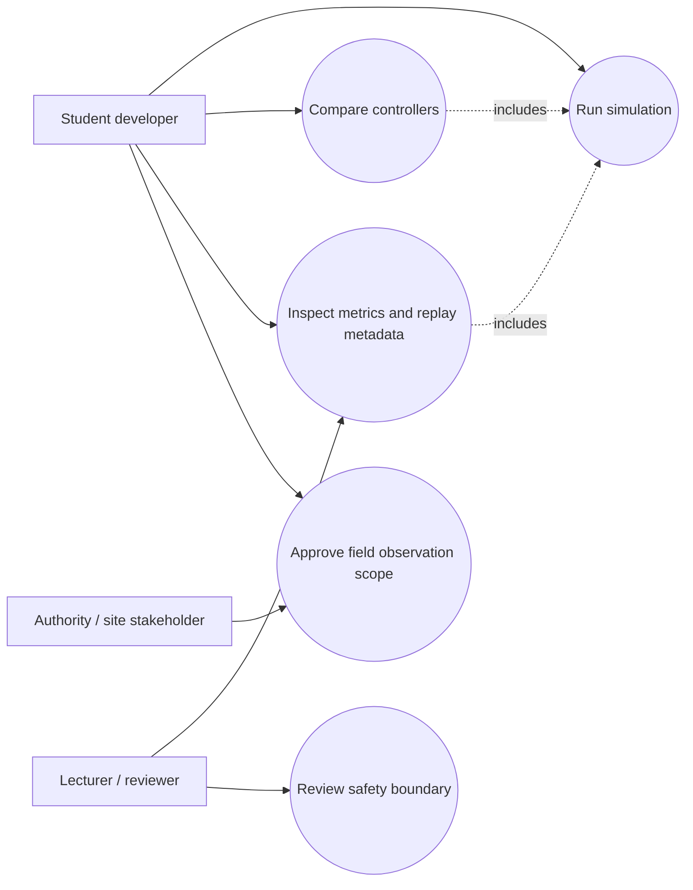
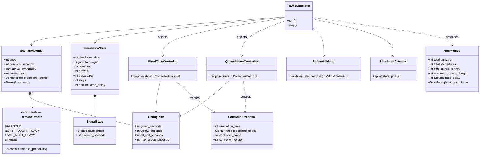
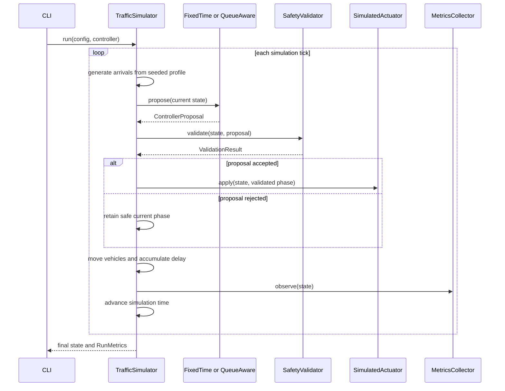
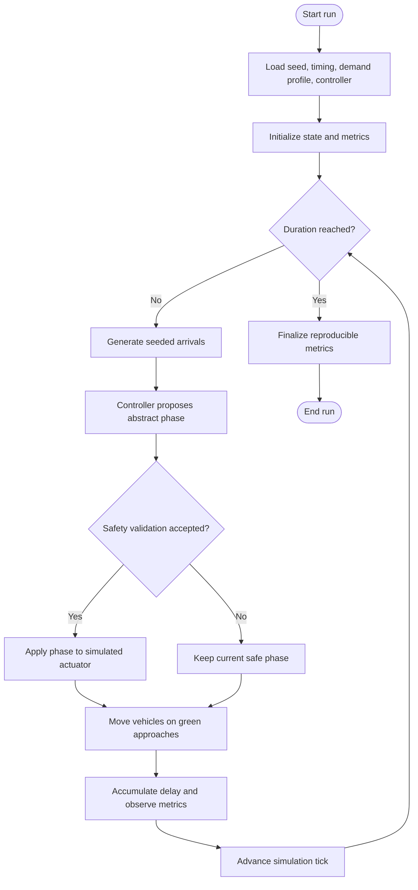
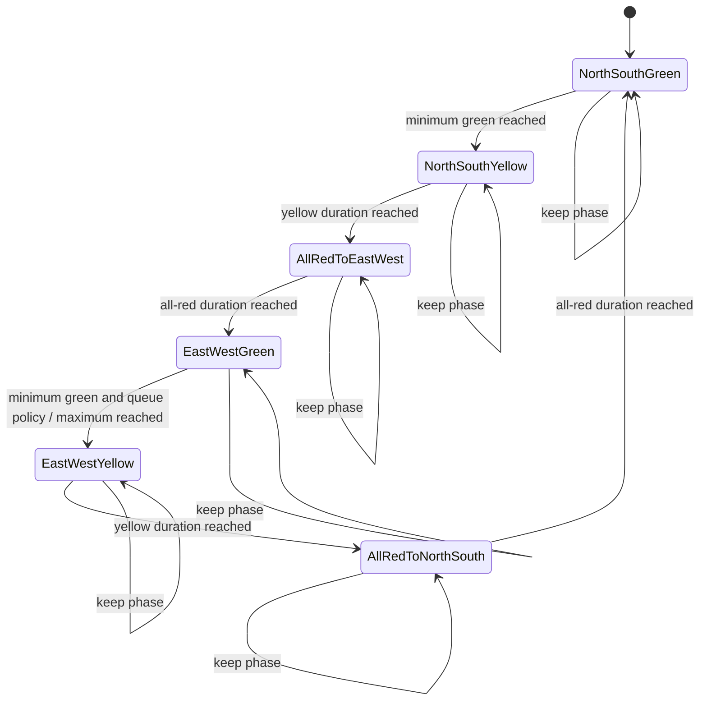
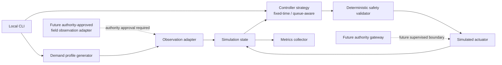
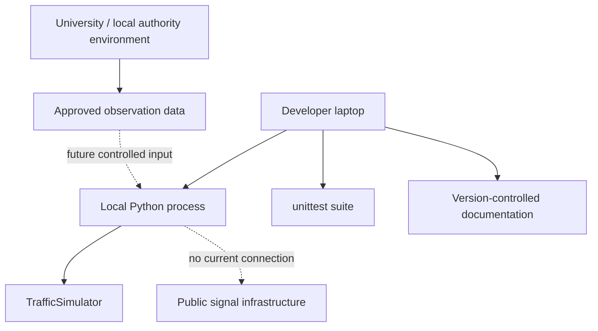

# MTACS UML Models

> **Status:** First executable vertical slice; diagrams are maintained as Mermaid source so the team can render them in Markdown-compatible tools.
>
> **Assumption:** The five lecturer-required fundamentals are use-case, class, sequence, activity, and state-machine diagrams. Component and deployment views are included as supplementary architecture diagrams.

## 1. Use-case diagram — required fundamental

The authority actor can approve or constrain observation scope, but cannot be treated as an implicit authorization to actuate public infrastructure.

## 2. Class diagram — required fundamental

## 3. Sequence diagram — required fundamental

## 4. Activity diagram — required fundamental

## 5. State-machine diagram — required fundamental

The controller can propose only the current state or the next state. The validator rejects stale proposals and skipped transitions.

## 6. Component diagram — supplementary

## 7. Deployment diagram — supplementary

## 8. Review checklist

- Confirm the five required fundamentals against the lecturer’s exact terminology before submission.
- Keep controller proposals abstract and route every proposal through deterministic validation.
- Label field observation, shadow mode, and supervised pilot as future authority-gated stages.
- Update diagrams when the simulator, controller contract, or authority integration boundary changes.
